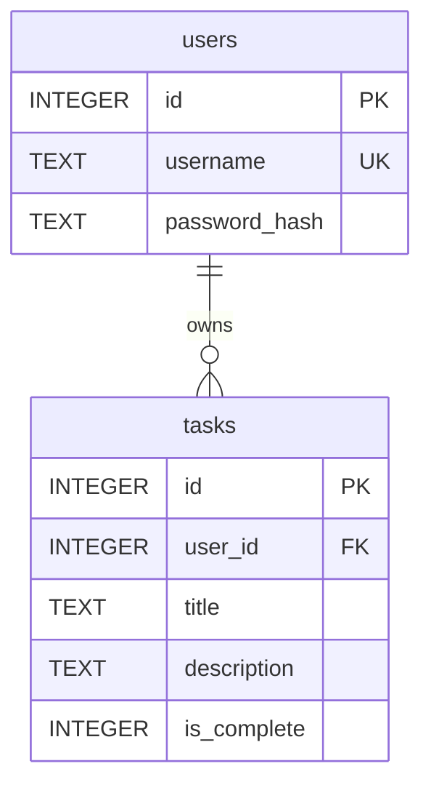

# Task Tracker

**A Flask task manager website with user accounts and private task lists.**

Built for **INF601 - Advanced Programming in Python, Mini Project 5** at Fort Hays State University.

**Author:** Coyt Mauch

## Contents

- [Description](#description)
- [Features](#features)
- [Pages and Routes](#pages-and-routes)
- [Requirements](#requirements)
- [Installation on Windows PowerShell](#installation-on-windows-powershell)
- [Initialize the Database](#initialize-the-database)
- [Run the Development Server](#run-the-development-server)
- [Run the Tests](#run-the-tests)
- [Database Design](#database-design)
- [Security](#security)
- [Project Structure](#project-structure)
- [Troubleshooting](#troubleshooting)
- [AI Usage](#ai-usage)
- [References](#references)

## Description

Task Tracker is a web application where each person creates an account, logs in, and manages their own
private list of tasks. Users can add tasks with a title and an optional description, edit them, mark
them complete, and delete them. Nobody can see or change another user's tasks.

The project follows the structure of the
[official Flask tutorial](https://flask.palletsprojects.com/en/stable/tutorial/):

- **Application factory.** `create_app()` in `tasktracker/__init__.py` builds and configures the app.
- **Blueprints.** `auth` handles accounts and `tasks` handles the task pages.
- **SQLite.** There are two linked tables, `users` and `tasks`, created by the
  `flask --app tasktracker init-db` command.
- **Jinja templates.** Every page extends one shared layout, `base.html`.
- **Bootstrap 5.3** provides the styling, the responsive navigation bar, and the delete confirmation dialog.

## Features

- **Accounts:** register, log in, and log out. Passwords are stored only as secure hashes.
- **Private dashboard:** your tasks as cards, with a progress bar showing how many you've completed.
- **Add and edit tasks:** a title (required, up to 100 characters), a description (optional, up to
  1000 characters), and a completed checkbox when editing.
- **Complete tasks:** mark a task complete or not complete with one click.
- **Delete tasks:** a Bootstrap pop-up asks you to confirm first, and it works with the keyboard and
  screen readers.
- **Form validation:** every form is checked on the server, and errors appear as red alerts.
- **Notifications:** Bootstrap alerts after every action. Green means success, red means an error, and
  blue is information.
- **Responsive design:** the navigation bar folds into a menu button on phones.
- **Consistent layout:** all seven pages, and error pages like 404 Not Found, extend `base.html`.

## Pages and Routes

The site has seven pages: **Home, About, Register, Log In, Dashboard, Add Task, and Edit Task.**

| URL | Methods | What it does | Login required |
|---|---|---|---|
| `/` | GET | Home page | No |
| `/about` | GET | About page | No |
| `/auth/register` | GET, POST | Registration form; creates the account | No |
| `/auth/login` | GET, POST | Login form; starts the session | No |
| `/auth/logout` | POST | Ends the session, then goes to Home | No |
| `/tasks/` | GET | Dashboard: your tasks | Yes |
| `/tasks/new` | GET, POST | Add Task form; saves the new task | Yes |
| `/tasks/<id>/edit` | GET, POST | Edit Task form; saves the changes | Yes, and it must be your task |
| `/tasks/<id>/toggle` | POST | Marks the task complete or not complete | Yes, and it must be your task |
| `/tasks/<id>/delete` | POST | Deletes the task | Yes, and it must be your task |

Every action that changes data only accepts POST: logging out, completing, deleting, and submitting
forms. Visiting a link can never change anything.

## Requirements

- **Windows with Windows PowerShell.** The commands below were tested in Windows PowerShell 5.1.
- **Python 3.10 or newer.** The pinned versions of click and pytest require at least 3.10. The project
  was built and tested with **Python 3.13.15**.
- **An internet connection** while using the site, because Bootstrap loads from the jsDelivr CDN.
  Without it the pages still work but look unstyled.
- **Python packages**, listed with exact versions in `requirements.txt`:

  | Package | Version | Used for |
  |---|---|---|
  | Flask | 3.1.3 | The web framework |
  | Werkzeug | 3.1.9 | Password hashing and the development server (installed with Flask) |
  | Jinja2 | 3.1.6 | HTML templates (installed with Flask) |
  | pytest | 9.1.1 | Running the tests |

  The other lines in `requirements.txt` (blinker, click, colorama, iniconfig, itsdangerous,
  MarkupSafe, packaging, pluggy, and Pygments) are packages that Flask and pytest need.

- **Optional, for the browser tests only:** Selenium and Microsoft Edge (see
  [Browser tests](#optional-browser-tests)).

## Installation on Windows PowerShell

Run these commands in **Windows PowerShell**, one at a time.

**1. Get the project and open its folder.**

```powershell
git clone <your-repository-url>
cd miniproject5coytmauch
```

Replace `<your-repository-url>` with this repository's GitHub URL, or download the ZIP from GitHub and
open PowerShell in the extracted folder.

**2. Create a virtual environment.**

```powershell
python -m venv .venv
```

This creates a `.venv` folder that keeps this project's packages separate from the rest of your
computer.

**3. Allow PowerShell to run the activation script.**

On a default Windows setup, PowerShell blocks scripts. Without this step, step 4 fails with *"running
scripts is disabled on this system"*.

```powershell
Set-ExecutionPolicy -Scope Process -ExecutionPolicy RemoteSigned
```

If PowerShell asks you to confirm, type `Y` and press Enter. This only affects the current PowerShell
window, so you'll need to run it again in each new window. To
allow scripts permanently for your Windows account instead, run this once:

```powershell
Set-ExecutionPolicy -Scope CurrentUser -ExecutionPolicy RemoteSigned
```

**4. Activate the virtual environment.**

```powershell
.venv\Scripts\Activate.ps1
```

Your prompt now starts with `(.venv)`. From here on, `python`, `pip`, and `flask` all use this
project's virtual environment. Run `deactivate` when you're finished.

**5. Install the required packages.**

```powershell
pip install -r requirements.txt
```

## Initialize the Database

Create the SQLite database and its tables:

```powershell
flask --app tasktracker init-db
```

You should see:

```text
Initialized the database at C:\...\miniproject5coytmauch\instance\tasktracker.sqlite
```

The `init-db` command runs `tasktracker/schema.sql`, which creates the `users` and `tasks` tables.

> **Warning:** running `init-db` again **deletes every user and task** and starts over with empty
> tables. Only run it for a fresh start.

### The database file stays on your computer

The database file, `instance/tasktracker.sqlite`, is **generated locally and is not committed to
GitHub.** The `.gitignore` file lists the whole `instance/` folder, so Git never tracks it. That's why
a fresh copy of this repository has no `instance` folder until you run `init-db`.

There are three reasons for this:

- **Everyone starts with their own empty database.** Nobody downloads anyone else's accounts or tasks.
- **It keeps private data off GitHub.** The database holds usernames and password hashes.
- **It avoids conflicts.** The file changes every time someone uses the app, which would cause
  constant Git changes.

## Run the Development Server

With the virtual environment active, start the server:

```powershell
flask --app tasktracker run --debug
```

Then open **<http://127.0.0.1:5000/>** in your browser. Register an account, log in, and start adding
tasks. Press **Ctrl+C** in PowerShell to stop the server.

The `--debug` flag reloads the server when you change the code and shows detailed error pages. Use it
only for development.

### Secret key

Flask signs the login session cookie with a secret key. The app falls back to the development-only key
`"dev"`. Anywhere other than your own computer, set the `SECRET_KEY` environment variable to a long
random value before starting the server:

```powershell
$env:SECRET_KEY = python -c "import secrets; print(secrets.token_hex())"
flask --app tasktracker run
```

This sets the key for the current PowerShell window only. Never commit a real secret key to Git.

## Run the Tests

With the virtual environment active, run:

```powershell
python -m pytest
```

Expected result:

```text
126 passed, 1 skipped
```

The one skipped item is the browser test file, which only runs when Selenium is installed (see
[below](#optional-browser-tests)). Use `python -m pytest` rather than `pytest`. That puts the project
folder on Python's import path, so the tests can import the `tasktracker` package.

**Your data is safe.** Every test gets its own new SQLite database in a temporary folder, filled with
two test users from `tests/data.sql`. The tests never open `instance/tasktracker.sqlite`. As an extra
safety net, `conftest.py` fails the test run if that file changes while the tests run.

| Test file | Tests | What it covers |
|---|---|---|
| `test_auth.py` | 24 | Registration, every validation rule, login, wrong and invalid passwords, logout, sessions |
| `test_db.py` | 13 | Database connections, both tables' columns, foreign key enforcement, `init-db` |
| `test_factory.py` | 22 | App configuration, secret key, all seven pages, navigation, error pages |
| `test_tasks.py` | 45 | Adding, editing, completing, and deleting tasks; validation; login protection on every task route; one user can't view or change another user's tasks |
| `test_project.py` | 22 | Header comments, template inheritance, `requirements.txt`, `.gitignore` |
| `test_browser.py` | 16 | The delete confirmation dialog and phone navigation in a real browser (optional) |

### Optional browser tests

The delete confirmation dialog runs on Bootstrap's JavaScript, which only a real browser can run.
`tests/test_browser.py` starts the app with its own temporary database and controls Microsoft Edge
with Selenium. It checks that:

- the dialog names the right task;
- Cancel, Escape, the X button, and clicking outside all delete nothing;
- confirming deletes only that task;
- the dialog works with the keyboard alone.

To run these tests too:

```powershell
pip install selenium
python -m pytest
```

Expected result:

```text
142 passed
```

These tests need Microsoft Edge and an internet connection. The first time, Selenium automatically
downloads the matching Edge driver. Selenium is optional, so it isn't listed in `requirements.txt`.

## Database Design

The database has two tables, linked by a **foreign key**. This is the actual schema from
`tasktracker/schema.sql`:

```sql
CREATE TABLE users (
  id INTEGER PRIMARY KEY AUTOINCREMENT,
  username TEXT UNIQUE NOT NULL,
  password_hash TEXT NOT NULL
);

CREATE TABLE tasks (
  id INTEGER PRIMARY KEY AUTOINCREMENT,
  user_id INTEGER NOT NULL,
  title TEXT NOT NULL,
  description TEXT NOT NULL DEFAULT '',
  -- SQLite has no boolean type: 0 = not complete, 1 = complete
  is_complete INTEGER NOT NULL DEFAULT 0 CHECK (is_complete IN (0, 1)),
  FOREIGN KEY (user_id) REFERENCES users (id)
);
```



### The `users` table

The `users` table has one row per account:

- **`id`:** a number SQLite assigns to each user automatically (the primary key).
- **`username`:** must be unique, so no two accounts share a name.
- **`password_hash`:** a salted hash made by Werkzeug's `generate_password_hash`. The password itself
  is never stored. At login, `check_password_hash` compares the typed password against this hash.

### The `tasks` table

The `tasks` table has one row per task:

- **`id`:** each task's own number (the primary key).
- **`user_id`:** the `id` of the user who owns the task. This is the **foreign key**.
- **`title`:** required.
- **`description`:** optional, and saved as empty text when left blank.
- **`is_complete`:** `0` for not complete or `1` for complete. The `CHECK` rule rejects any other value.

### How the two tables are linked

`FOREIGN KEY (user_id) REFERENCES users (id)` creates a **one-to-many relationship**. One user can own
many tasks, and every task belongs to exactly one user. `users` is the *parent* table and `tasks` is the
*child* table.

SQLite only enforces foreign keys when they're turned on for each database connection. So `get_db()` in
`tasktracker/db.py` runs `PRAGMA foreign_keys = ON` every time it connects. With enforcement on:

- **A task must belong to a real user.** Adding or moving a task to a `user_id` that doesn't exist fails
  with `FOREIGN KEY constraint failed`.
- **A user who still owns tasks can't be deleted.** Their tasks would be left pointing at nothing.
- **`init-db` drops `tasks` before `users`** for the same reason.

The app also uses this link to keep tasks private:

- **The dashboard shows only your tasks.** It runs
  `SELECT * FROM tasks WHERE user_id = ?` with the logged-in user's id.
- **Other users' tasks look like they don't exist.** Opening, editing, completing, or deleting a task
  goes through `get_task()`, which matches both the task's `id` *and* your `user_id`. Another user's
  task gives a 404 Not Found.

## Security

- **Passwords are hashed** with Werkzeug, so plaintext passwords are never stored.
- **Login sessions** use Flask's signed session cookie, which holds only the user's id. It can't be
  edited without the secret key.
- **Private pages** use the `@login_required` decorator. Logged-out visitors are sent to the login page.
- **Users can only see and change their own tasks.** The owner's id always comes from the session,
  never from the form.
- **State changes use POST**, and the session cookie is set to `SameSite=Lax`.
- **Parameterized SQL.** Every query passes user input as `?` parameters, so input can't change the
  SQL.
- **Escaped output.** Jinja escapes everything it displays, so HTML typed into a task can't run on the
  page.
- **Server-side validation** on every form. The browser checks the same rules first, for convenience.
- **Pinned Bootstrap files.** The Bootstrap links include `integrity` hashes, so the browser refuses
  the files if the CDN ever serves something different.

**Known limitations:**

- The forms don't use CSRF tokens; the `SameSite=Lax` cookie and POST-only actions reduce this risk.
- Usernames are case-sensitive, so `Test` and `test` are different accounts.
- The development server is for development only.

## Project Structure

```text
miniproject5coytmauch/
├── tasktracker/                 # The Flask application package
│   ├── __init__.py              # create_app(): config, Home and About routes, error pages
│   ├── auth.py                  # "auth" blueprint: register, login, logout, @login_required
│   ├── tasks.py                 # "tasks" blueprint: dashboard, add, edit, complete, delete
│   ├── db.py                    # SQLite connections, cleanup, and the init-db command
│   ├── schema.sql               # Creates the users and tasks tables
│   ├── static/
│   │   ├── favicon.svg          # Browser tab icon
│   │   └── style.css            # Small additions on top of Bootstrap
│   └── templates/
│       ├── base.html            # Shared layout: Bootstrap, navbar, alerts, footer
│       ├── home.html            # Home
│       ├── about.html           # About
│       ├── error.html           # 404 and other error pages
│       ├── auth/
│       │   ├── register.html    # Register
│       │   └── login.html       # Log In
│       └── tasks/
│           ├── dashboard.html   # Dashboard, plus the delete confirmation dialog
│           ├── new.html         # Add Task
│           └── edit.html        # Edit Task
├── tests/
│   ├── conftest.py              # Test setup: temporary database, test client, login helper
│   ├── data.sql                 # Two test users, each with one task
│   ├── test_auth.py
│   ├── test_browser.py          # Optional; needs Selenium and Microsoft Edge
│   ├── test_db.py
│   ├── test_factory.py
│   ├── test_project.py
│   └── test_tasks.py
├── .gitignore                   # Keeps .venv/, instance/, caches, and secrets out of Git
├── requirements.txt             # Exact package versions
└── README.md

Created on your computer (not in Git):
├── .venv/                       # Virtual environment (step 2 of Installation)
└── instance/
    └── tasktracker.sqlite       # The database (flask --app tasktracker init-db)
```

## Troubleshooting

| What you see | What to do |
|---|---|
| `.venv\Scripts\Activate.ps1 cannot be loaded because running scripts is disabled on this system` | Run `Set-ExecutionPolicy -Scope Process -ExecutionPolicy RemoteSigned`, then activate again (Installation step 3). |
| `The term 'flask' is not recognized as the name of a cmdlet, function, script file, or operable program` | The virtual environment isn't active. Run `.venv\Scripts\Activate.ps1`. |
| An error page showing `sqlite3.OperationalError: no such table: users` | The database hasn't been created. Run `flask --app tasktracker init-db`. |
| Port 5000 is already in use | Use another port: `flask --app tasktracker run --debug --port 5001`. |
| The pages have no styling | Bootstrap couldn't load from the CDN. Check your internet connection. |

## AI Usage

This project was built with the help of **Claude Code**, Anthropic's AI coding assistant, running the
**Claude Opus 5.5** model in the terminal. All of the work below happened on October 25, 2026, in one
step-by-step session. For each step, I gave Claude Code a prompt describing what to build, and Claude
Code wrote the code, ran it, and explained its changes.

### What Claude Code did

1. **Project setup.** Wrote `.gitignore`. Created the `tasktracker` package, the `create_app()`
   factory, the working Home and About routes, placeholder templates using `base.html`, and the first
   tests.
2. **Database.** Wrote `schema.sql` with the linked `users` and `tasks` tables. Wrote `db.py`, which
   handles per-request connections and cleanup, turns on `PRAGMA foreign_keys` for every connection,
   and adds the `init-db` command.
   - It found and fixed a problem where `init-db` crashed when run from tests.
3. **User accounts.** Wrote registration, login, and logout using Flask sessions and Werkzeug password
   hashing. Added form validation, error messages, the `@login_required` decorator, and a secret key
   that an environment variable can override.
4. **Task management.** Wrote the dashboard, Add Task, Edit Task, complete, and delete features. These
   include server-side validation, ownership checks so users can't reach each other's tasks, and
   POST-only actions.
   - It changed logout from a link to a POST form.
   - It added a shared error page and fixed a phone layout problem.
5. **Bootstrap styling.** Restyled every page with Bootstrap 5.3.8 and built the delete confirmation
   dialog. It checked the CDN files' integrity hashes against Bootstrap's website. Testing in a real
   browser turned up four problems, which it fixed:
   - keyboard focus could escape the dialog;
   - the browser blocked an accessibility attribute while closing the dialog;
   - the navigation links had low color contrast;
   - the browser tab icon was missing.
6. **Testing and review.** Wrote the automated test files (142 tests), including the Selenium browser
   tests and the safety check that keeps tests away from the real database. It also found and fixed a
   problem in `requirements.txt`: the file was saved in a format (UTF-16) that Git treated as binary.
7. **This README.** Before documenting each command, Claude Code ran it in a fresh copy of the
   repository in Windows PowerShell.

### How Claude Code checked its work

- It ran the test suite after every change and reported failures instead of hiding them.
- It took screenshots in headless Microsoft Edge to check the layout on desktop and phone screens.
- It used Selenium to click and type through the app in a real browser.
- It broke the code on purpose in five ways, on a separate copy, to confirm the tests catch real bugs.
  The five ways were: removing the ownership check, turning off foreign keys, allowing logout by GET,
  and removing each of the dialog's two keyboard and focus fixes.
- It ran the install, database, server, and test commands in a fresh clone of this repository.

Claude Code did not make any Git commits. I made every commit myself.

### My own work, testing, and decisions

> *Coyt: write this section yourself before submitting, in your own words. Replace these prompts.*

- *How I planned the project, and why I chose a task manager.*
- *What I asked for in each step, and what I reviewed, changed, or rejected in Claude Code's work.*
- *How I tested the app myself: what I tried in the browser, and anything that didn't work at first.*
- *Decisions I made, and why.*
- *What I learned about Flask, SQLite, authentication, testing, or working with an AI assistant.*

## References

- [Flask tutorial](https://flask.palletsprojects.com/en/stable/tutorial/) and its
  [application factory](https://flask.palletsprojects.com/en/stable/tutorial/factory/) chapter
- [Bootstrap 5.3 documentation](https://getbootstrap.com/docs/5.3/) and its
  [modal component](https://getbootstrap.com/docs/5.3/components/modal/)
- [SQLite foreign key support](https://www.sqlite.org/foreignkeys.html)
- [Werkzeug utilities](https://werkzeug.palletsprojects.com/en/stable/utils/), including
  `generate_password_hash` and `check_password_hash`
- [Python `venv` documentation](https://docs.python.org/3/library/venv.html)
- [About PowerShell execution policies](https://learn.microsoft.com/en-us/powershell/module/microsoft.powershell.core/about/about_execution_policies)
- [Selenium Manager](https://www.selenium.dev/documentation/selenium_manager/), which downloads the
  Edge driver for the browser tests
